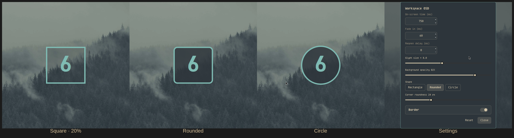

# Workspace OSD

A giant, theme-aware number that flashes in the center of the screen whenever
the active Hyprland workspace changes — for [Omarchy](https://omarchy.org/)
(Quickshell) on Arch Linux.

Omarchy ships **no** built-in workspace-number OSD (its `omarchy.osd` panel only
covers volume/brightness, and workspace numbers otherwise live in the bar). This
plugin adds a large centered overlay instead — and **no bar icon**: it is a
standalone `panel`, so it works even when the Omarchy bar is hidden.

Fully configurable from a settings panel: on-screen time, fade, size, opacity,
**shape** (rectangle / rounded / circle) and **border**.

## Preview



## Features

- Large centered workspace number on every workspace change.
- **No bar icon / no bar footprint** — a standalone overlay, not a bar widget;
  works even if you hide the Omarchy bar.
- Theme-aware: uses the active Omarchy theme (`Color.accent` for the number,
  `Color.background` for the card, `popups.border` for the outline). Switches
  live with the theme.
- Selectable shape: `rectangle`, `rounded`, `circle`.
- Optional border. When the border is off, only the number is drawn (fully
  transparent background).
- Adjustable duration, fade-in, reopen delay, glyph size and opacity.
- Preferences live in a dedicated TOML file (hot-reloaded) and a built-in
  settings panel.

## Requirements

- Omarchy (uses `omarchy-shell` / Quickshell and the `qs.Commons` / `qs.Ui`
  singletons).
- Hyprland.
- No external dependencies.

## Install

```bash
omarchy plugin add https://github.com/iesta/omarchy-workspace-osd --enable
```

Then restart the shell so the panel mounts:

```bash
omarchy restart shell
```

## Usage

The OSD appears automatically on every workspace change — there is nothing to
click and **no bar icon** (it runs as a standalone overlay, even with the bar
hidden).

### Open the preferences

From the Omarchy menu (**Workspace OSD → Settings**) or with the command:

```bash
omarchy-shell shell call iesta.workspace-osd openSettings '{}'
```

Close it with:

```bash
omarchy-shell shell call iesta.workspace-osd closeSettings '{}'
```

### Map it to a shortcut

Bind the command in `~/.config/hypr/bindings.lua`, for example:

```lua
o.bind("SUPER + ALT + O", "Workspace OSD settings",
  "omarchy-shell shell call iesta.workspace-osd openSettings '{}'")
```

### Add it to the Omarchy menu

The plugin installs no menu entry of its own. To put a shortcut under
**Setup → Config**, add one line to
`~/.config/omarchy/extensions/omarchy-menu.jsonc` (the menu hot-reloads on save):

```jsonc
"setup.config.workspace-osd": {
  "icon":"󰒓",
  "label":"Workspace OSD",
  "action":"omarchy-shell shell call iesta.workspace-osd openSettings '{}'"
},
```

## Configuration

Preferences are stored in:

`~/.config/omarchy/workspace-osd.toml`

created automatically on first run. It is read live (edits apply without a
restart).

```toml
# shape: rectangle | rounded | circle
[workspace-osd]
duration = 750        # ms the number stays on screen
fade = 60             # fade-in duration, ms
reopen = 0            # delay before re-opening on rapid workspace changes, ms
size-multiplier = 7   # glyph size = base font size x N
opacity = 0.82        # card background opacity (only when border = true)
shape = "rounded"     # rectangle | rounded | circle
roundness = 24        # corner radius in px (rounded shape only)
border = false        # false => no outline, transparent background
```

| Key | Type | Default | Meaning |
|---|---|---|---|
| `duration` | int (ms) | `750` | On-screen time |
| `fade` | int (ms) | `60` | Fade-in duration |
| `reopen` | int (ms) | `0` | Reopen delay |
| `size-multiplier` | number | `7` | Glyph size multiplier |
| `opacity` | number (0–1) | `0.82` | Card opacity (bordered only) |
| `shape` | enum | `rounded` | `rectangle`, `rounded`, `circle` |
| `roundness` | int (px) | `24` | Corner radius (rounded shape only) |
| `border` | bool | `false` | Draw outline + card |

## Remove

```bash
omarchy plugin remove iesta.workspace-osd
```

Your config file at `~/.config/omarchy/workspace-osd.toml` is left in place;
delete it manually if you no longer need it.

## Files

| File | Purpose |
|---|---|
| `manifest.json` | Plugin manifest (kind `panel`, `keepLoaded`) |
| `WorkspaceOsd.qml` | OSD overlay, preference loading/persistence, IPC |
| `WorkspaceOsdSettings.qml` | Settings modal |
| `Config.js` | TOML parse/serialize + defaults |

## License

MIT — see [LICENSE](LICENSE).
